  
  
  

**iOS & Flutter Developer** based in **Mohali, India**, with **3.6+ years** of experience building and maintaining production mobile apps for iOS and Android. I work with Swift, SwiftUI, UIKit, Flutter and Dart, and I'm comfortable across REST APIs, Firebase, state management, local persistence, offline-first architecture, location services, Bluetooth thermal printing, and App Store / Google Play releases.

My work spans **POS and restaurant management, transportation, social networking, logistics and business apps**, with a focus on clean architecture, reusable components, debugging, performance and reliable production releases.

> 🔎 **Open to:** iOS Developer · Flutter Developer · Mobile Application Developer · iOS & Flutter Developer

## Journey

### Netset Software Solutions, Mohali · *Mar 2023 – Present*

Joined as an **iOS Jr. Developer**, was promoted to **iOS Sr. Developer**, and then grew into a **hybrid iOS & Flutter developer** after upgrading my Flutter skills.

- Develop and maintain production apps with **Swift, SwiftUI, UIKit, Flutter and Dart** across iOS and Android.
- Build responsive, reusable interfaces from product requirements and designs, following maintainable architecture patterns.
- Integrate **RESTful APIs** for authentication, users, orders, payments, inventory, location, notifications and business workflows.
- Implement **offline-first** functionality: local persistence, caching, queued operations and sync when connectivity returns.
- Integrate **Firebase** (authentication, push notifications, analytics, cloud functionality) and **Google Maps / Geolocation** features.
- Integrate **Bluetooth thermal printers** for restaurant POS, KOT and receipt workflows.
- Work with **Hive** and **SwiftData** for reliable local data management.
- Debug production issues across API failures, sync, state management, navigation, database operations, printing and performance.
- Collaborate with backend developers, designers, QA and product teams from development to release; manage builds, signing, **TestFlight**, **App Store** and **Google Play** releases.

## Selected work

### Flutter projects

  
  

  
  

  
  

### Native iOS projects

  

  

  

  

  

  

### watchOS & health

- Built watchOS functionality with **HealthKit, WatchConnectivity, SwiftData** and workout/session APIs.
- Implemented health monitoring workflows — heart rate, blood oxygen, steps and exercise — with iPhone ↔ Apple Watch communication.
- Worked with background processing and scheduled tasks for app synchronization and data operations.

## Open source

  

  

  
  

  

Heatmap and statistics come from third-party services using public GitHub data and may be cached or briefly unavailable. A contribution-snake workflow is included in <code>.github/workflows/snake.yml</code>.

  
  
  

